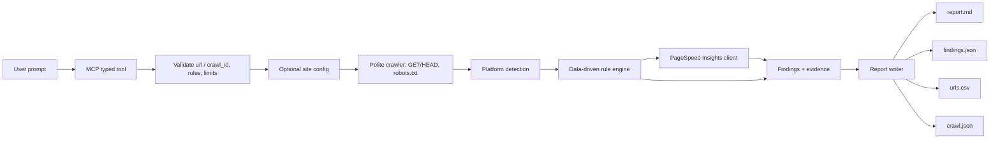
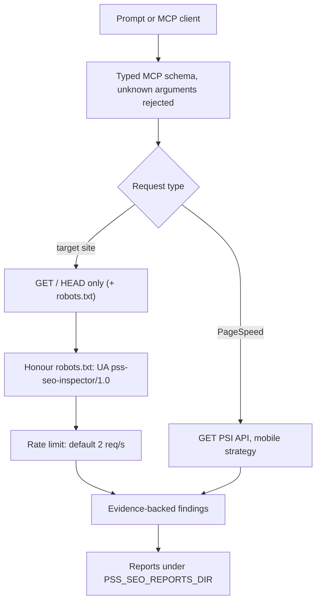
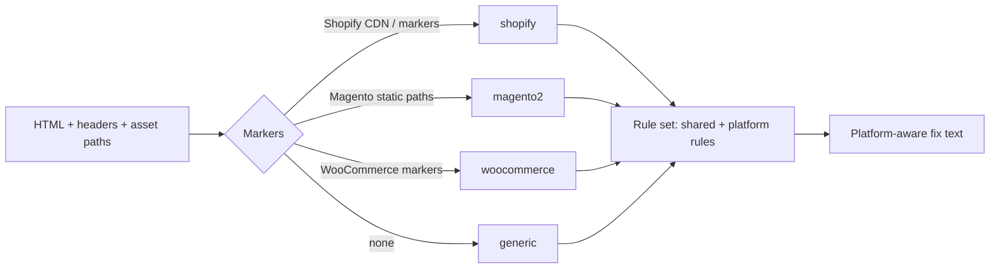
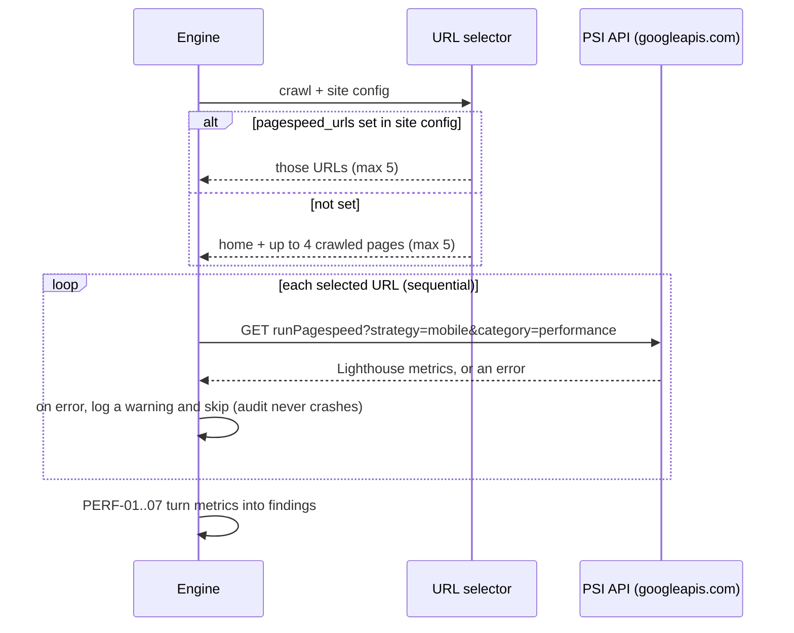
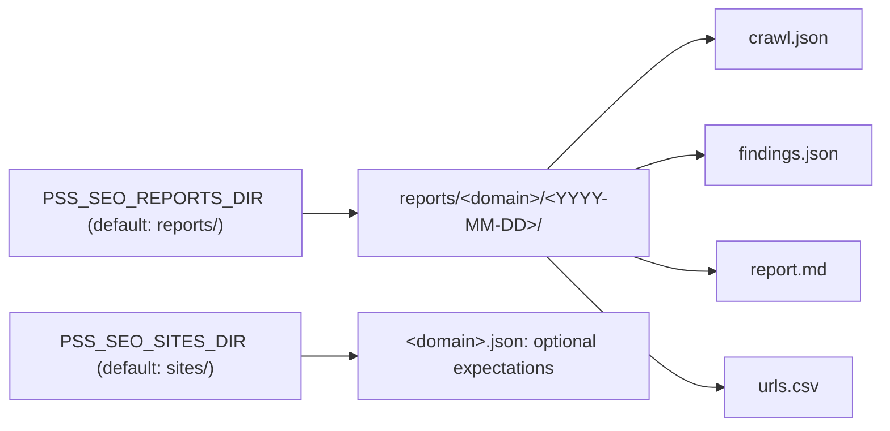

# pss-seo-inspector Architecture

This document describes the public, read-only architecture. All brands,
domains, and paths in the examples are synthetic (`example.test`,
`Acme Optics`).

## Crawl-to-report flow

The prompt becomes typed tool arguments; it never becomes a shell command or a
raw request to the target site. The crawler collects pages, redirects,
robots.txt and sitemaps once; rules then run over that data, so a re-audit from
a saved `crawl.json` needs no network access. PageSpeed Insights is the only
step that calls an external service (Google's PSI API) and only for a capped
set of URLs.

## Read-only boundary

The server never submits forms, logs in, adds to carts, or sends any mutating
HTTP method. It issues `GET`/`HEAD` to the target site plus `robots.txt`, and a
`GET` to the PageSpeed Insights endpoint. There is no generic request tool: a
caller cannot ask it to `POST`, upload, or run arbitrary URLs with arbitrary
methods. robots.txt is honoured with Google's matching rules, requests are rate
limited, and every finding carries a URL and the evidence behind it.

## Platform detection and rule scope

Rules declare the platforms they apply to and a scope (`page` or `site`).
A rule that does not apply to the detected platform is reported as skipped, not
as a failure. Fix guidance is platform-aware: a Shopify theme hint differs from
a Magento admin hint, and generic advice is used when the platform is unknown.

## PageSpeed Insights integration

The PSI client uses the mobile strategy, a 30-second timeout per call, and an
optional API key from `PSS_PAGESPEED_API_KEY`. Without a key the public PSI
rate limit applies, so the selection is capped at five URLs. A failed PSI call
(network error, 429, malformed response) is logged and skipped; the rest of the
audit still completes and writes its report.

## Storage model

Reports are written under `PSS_SEO_REPORTS_DIR` (default `reports/` in the
checkout), one dated folder per domain; a same-day re-run overwrites it. Site
configs are read from `PSS_SEO_SITES_DIR` (default `sites/`), not from the MCP
client's working directory. `crawl.json` holds the raw crawl so rules re-run
offline.

## Privacy

The tool stores crawl data and reports for the sites it audits. These may
contain page content, titles, and URLs from real sites and should be treated as
private. Keep `reports/` and real per-site configs out of any public
repository; this repository ignores `reports/` and every `sites/*.json` except
the synthetic `example.test.json`. A PageSpeed Insights API key is read from an
environment variable and must never be committed.
